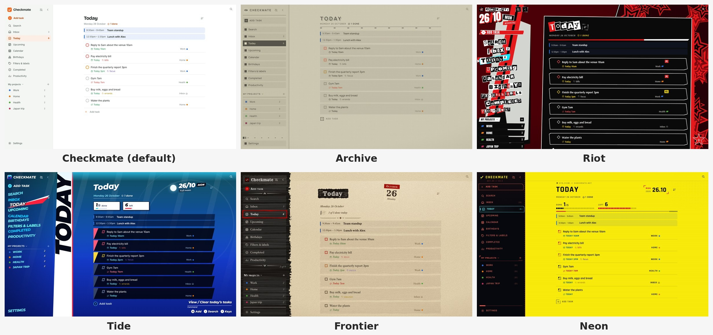
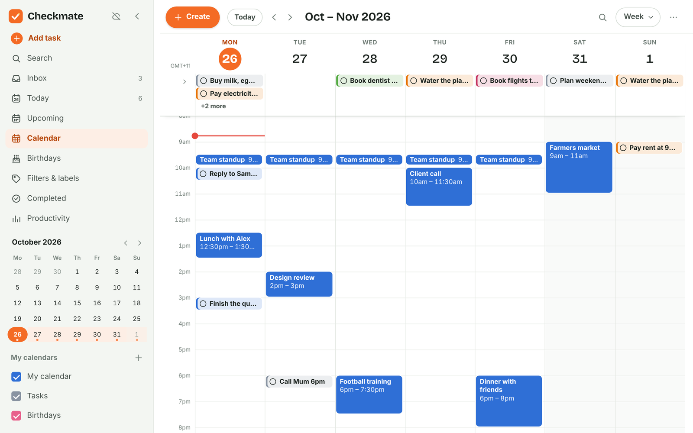

<h1 align="center">✅ Checkmate</h1>

<p align="center">
  <b>A to-do list and calendar that looks like a game menu.</b><br>
  Six styles that change the whole interface, tasks you type in plain English or Chinese,<br>
  and sync through a Firebase project only you own. Windows, Android, Chrome/Edge and any browser.
</p>

<p align="center">
  <a href="https://github.com/TymonBitesTheDust/Checkmate/releases/latest"></a>
  
  <a href="LICENSE"></a>
  
</p>

<p align="center">
  <a href="https://tymon.website/theWorks/checkmate#demo"><b>▶ Try it in your browser</b></a> (nothing to install) ·
  <a href="#download">Download</a> ·
  <a href="#how-its-built">How it's built</a>
</p>

<p align="center">
  
</p>

## What makes it different

**Six styles, and each one is a whole new interface.** Not a colour swap: every style has its own layout, fonts, page transitions, sounds, cursor, app icon and start screen, in light and dark.

| Style | What it's like |
| --- | --- |
| **Checkmate** | Clean and quiet, with a theme colour you pick |
| **Archive** | Beige menu plates with sliding rules and a stepped progress bar |
| **Riot** | Red and black, cut-out ransom-note letters, a slash and a stamp when you finish a task |
| **Tide** | A deep-blue pause menu with moving water light and a tilted command list |
| **Frontier** | An ink-roller menu with a red brush frame and an almanac date |
| **Neon** | Terminal menus with cut corners, cyan highlights and a glitch on start |

**Type tasks the way you'd say them.** Checkmate picks out the date, time, repeat, priority, project and labels as you type.

| Type this | You get |
| --- | --- |
| `Pay rent every 1st at 9am p1 #Home @bills` | Monthly, top priority, in Home, labelled bills |
| `Gym every mon wed fri 7am` | Repeats three times a week |
| `明天下午5點 打電話給阿明` | Tomorrow at 5 pm. Chinese works too |

**Monash students: your whole semester in one place** (new in 3.3.0). Paste your private calendar links from Moodle and Allocate+ and your lectures, tutorials, homework, quizzes and exams appear on the calendar in separate layers. Every assignment, quiz and exam also becomes a task in a Monash project, in date order. If Moodle moves a deadline, the task moves too. Checkmate never asks for your Monash password. Turn it on in **Settings → Add-ons**.

**Claude can run it for you.** Connect Claude and ask *"what's due today?"*, *"move everything overdue to tomorrow"* or *"block 9–11am every weekday for focus time"*. See the [Claude setup guide](docs/GUIDE.md#using-checkmate-with-claude-once-about-5-minutes).

**Your data stays yours.** Checkmate works offline on one device straight away. To sync, it uses a free Firebase project that only you own, so there's no server of mine in between, and Checkmate collects no data ([privacy policy](PRIVACY.md)).

**And the rest of what you'd expect:** day, week, month, year and schedule views with drag to create and move, Google Calendar inside the calendar, projects, sections and boards, subtasks, labels, filters, comments, files on tasks (up to 100 MB), reminders as notifications, birthdays (including lunar birthdays), a productivity page, Google Docs and Sheets as task lists, backups, and English or Traditional Chinese (繁體中文).

<p align="center"></p>

## How it's built

One Preact app, shipped four ways. Every build syncs through the user's own Firebase project.

| Build | Platform | What it is |
| --- | --- | --- |
| `Checkmate.html` | Any browser | The whole app (code, fonts, icons, cursors) bundled by esbuild into one offline HTML file |
| `Checkmate.exe` | Windows 10/11 | A small Go program that shows the app in WebView2, with tray notifications |
| `Checkmate.apk` | Android 7+ | A Java WebView wrapper with native reminders (AlarmManager) and a launcher icon per style |
| `Checkmate-extension.zip` | Chrome/Edge 116+ | A Manifest V3 extension: the app in a tab, a quick-add popup and reminders as notifications |

Plus `connector/`: a remote MCP server for Cloudflare Workers (OAuth 2.1 with PKCE, 16 tools) that lets Claude read and change your tasks and calendar in your own Firestore.

Some parts that might interest you:

- **`web/src/parse.js`**: the natural-language quick-add parser, in English and Chinese (dates, times, repeats, `p1`–`p4`, `#project`, `/section`, `@label`).
- **`web/src/store.js` and `sync.js`**: a local-first store that works offline and syncs through Firestore.
- **`web/src/recur.js`, `tz.js` and `ics.js`**: RRULE repeats, events in their own time zones, and .ics import and export.
- **`web/src/birthdays.js`**: lunar birthdays from a built-in table for 1900–2100.
- **`web/src/sound.js`**: every sound in every style is synthesised with WebAudio, with no audio files.
- **`web/src/skin-*.css` and `riot.jsx`, `tide.jsx`, `frontier.jsx`, `neon.jsx`**: the styles.
- **`test/`**: browser tests for each style, sync between two devices, Chinese, the extension and the connector.

Built by one developer with Claude AI.

### Build it yourself

```bash
(cd web && npm install)
(cd web && node build.mjs)     # just the browser version, the quickest way to start
TOOLS=~/tools ./build.sh       # everything: .html, .exe, .apk (dev-signed) and the extension
```

The full build also needs Go 1.24, JDK 17+ and a few Android tools. [docs/DEVELOPING.md](docs/DEVELOPING.md) has the setup, a map of every file, how sync works and how to run the tests.

## Download

| | Download | Works on |
| --- | --- | --- |
| 🌐 **Browser** | [**Try it now**](https://tymon.website/theWorks/checkmate#demo), or download [**Checkmate.html**](https://github.com/TymonBitesTheDust/Checkmate/releases/latest/download/Checkmate.html) | Any modern browser, also offline |
| 🪟 **Windows** | [**Checkmate.exe**](https://github.com/TymonBitesTheDust/Checkmate/releases/latest/download/Checkmate.exe) | Windows 10 and 11 (64-bit) |
| 🤖 **Android** | [**Checkmate.apk**](https://github.com/TymonBitesTheDust/Checkmate/releases/latest/download/Checkmate.apk) | Android 7.0 and newer |
| 🧩 **Chrome / Edge** | [**Checkmate-extension.zip**](https://github.com/TymonBitesTheDust/Checkmate/releases/latest/download/Checkmate-extension.zip) | Chrome or Edge 116 and newer |

The Monash add-on reads your Moodle and Allocate+ links in the Windows and Android apps (a browser page isn't allowed to). Add them on any device and they sync to the rest.

<details>
<summary><b>Install steps</b></summary>

**Windows**: Open `Checkmate.exe`. There's no installer. If Windows says *"Windows protected your PC"*, choose **More info → Run anyway** (the app isn't code-signed yet).

**Android**: Open `Checkmate.apk` on your phone and tap **Install**. If asked, allow your browser or file manager to *install unknown apps*. If Play Protect warns you, choose **Install anyway**.

**Chrome / Edge**: Unzip `Checkmate-extension.zip`. Open `chrome://extensions` (in Edge, `edge://extensions`), turn on **Developer mode**, choose **Load unpacked** and pick the unzipped folder. Pin its toolbar button to add tasks from any page (`Alt+Shift+C`).

**Browser**: Open `Checkmate.html`. That's it.

</details>

<details>
<summary><b>Sync between devices (optional, about 5 minutes)</b></summary>

1. Create a free project at [console.firebase.google.com](https://console.firebase.google.com) and turn on **Email/Password** sign-in and **Firestore**.
2. In Checkmate, open **Settings → Sync**, paste your Firebase settings and create an account.
3. On your other devices, paste the **setup code** from the first device and sign in.

The [full guide](docs/GUIDE.md#setting-up-sync-once-about-5-minutes) has every click, plus the security rules to copy.

</details>

<details>
<summary><b>Keyboard shortcuts</b></summary>

`Q` add a task · `/` search · `G` then `T` / `I` / `U` / `L` / `B` go to Today / Inbox / Upcoming / Calendar / Birthdays · `?` show all shortcuts. You can change any of them in **Settings → Shortcuts**.

</details>

## What's new

**3.3.0**: Settings → Add-ons, with the Monash add-on as the first one; a timeline across Today; and keyboard shortcuts you can change. See the [release notes](releases/v3.3.0/RELEASE_NOTES.md) and [CHANGELOG.md](CHANGELOG.md) for every version.

## Help and contributing

- 📖 **[User guide](docs/GUIDE.md)**: every feature, step by step
- 🐞 **Found a bug or have an idea?** [Open an issue](https://github.com/TymonBitesTheDust/Checkmate/issues). Pull requests are welcome too. Every change has to look right in all six styles, in light and dark, and at phone width (390 px); [DEVELOPING.md](docs/DEVELOPING.md) explains how to check.
- ⭐ **Like it?** A star helps other people find it.

## About

Made by **Tymon Ng** in Melbourne, Australia, built with Claude AI. More of my projects are on [tymon.website](https://tymon.website/theWorks). If you'd like to support Checkmate, see **Settings → Donate** in the app (paid securely through Stripe). Checkmate used to be called *Tickwise*, and updating from it keeps all your data.

The styles are Checkmate's own designs. Checkmate isn't affiliated with or endorsed by any game publisher.

## License

[MIT](LICENSE) © Tymon Ng. `third_party/sys` is Go's `golang.org/x/sys` under its own [BSD license](third_party/sys/LICENSE).
