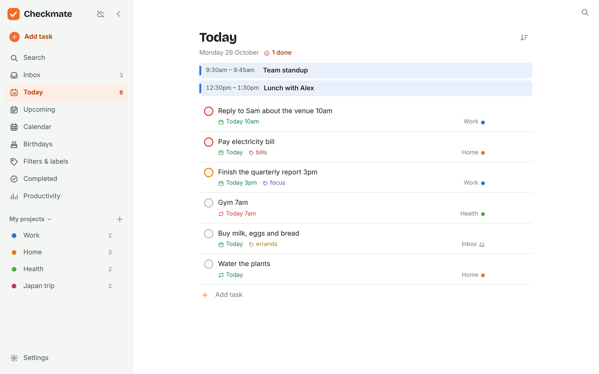
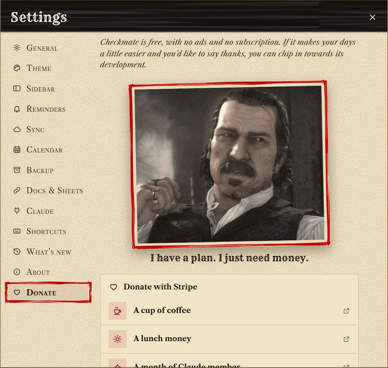
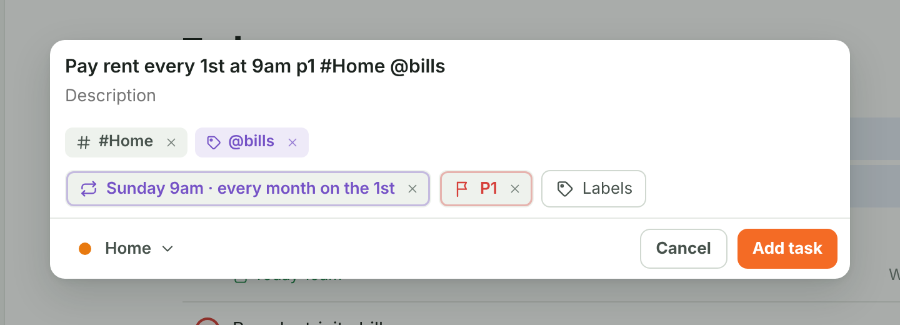
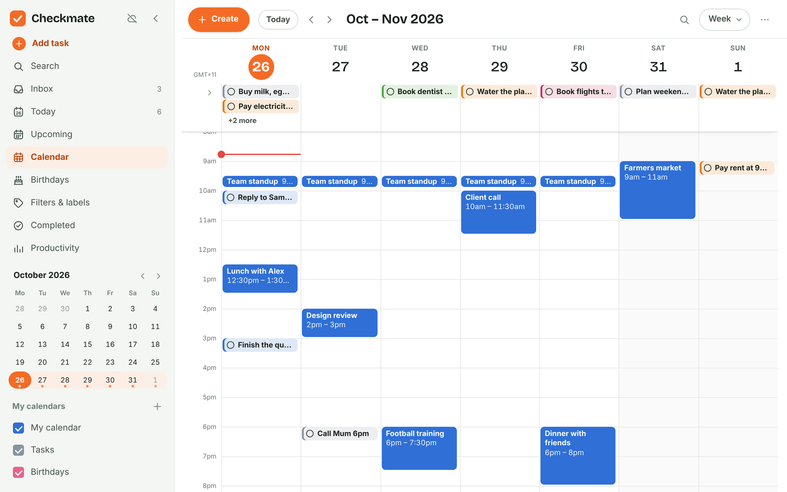
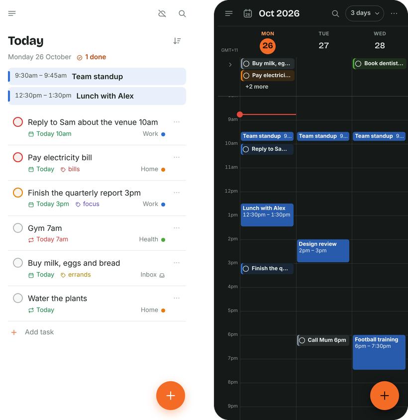
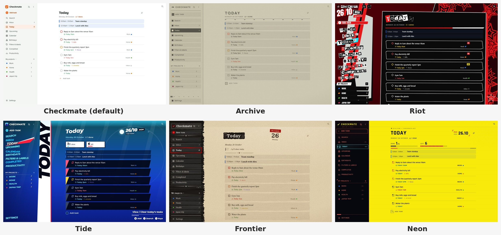

<h1 align="center">✅ Checkmate</h1>

  <b>A simple to-do list and calendar for Windows, Android, Chrome/Edge and any browser.</b> 
  Like Todoist and Google Calendar in one app — free, and your data stays in your own account.

  
  
  
  

  

## Download

| | Download | Works on |
| --- | --- | --- |
| 🪟 **Windows** | [**Checkmate.exe**](https://github.com/TymonBitesTheDust/Checkmate/releases/latest/download/Checkmate.exe) | Windows 10 and 11 (64-bit) |
| 🤖 **Android** | [**Checkmate.apk**](https://github.com/TymonBitesTheDust/Checkmate/releases/latest/download/Checkmate.apk) | Android 7.0 and newer |
| 🧩 **Chrome / Edge** | [**Checkmate-extension.zip**](https://github.com/TymonBitesTheDust/Checkmate/releases/latest/download/Checkmate-extension.zip) | Chrome or Edge 116 and newer |
| 🌐 **Browser** | [**Checkmate.html**](https://github.com/TymonBitesTheDust/Checkmate/releases/latest/download/Checkmate.html) | Any modern browser, also offline |

All downloads are on the [Releases page](https://github.com/TymonBitesTheDust/Checkmate/releases/latest).

## New in 3.1.2

- **Five ways to say thanks.** **Settings → Donate** has *A cup of coffee*, *A lunch money*, *A month of Claude member*, *A big thank!* and *A lunch money (per month)*. Each one opens its own secure Stripe page (card, Apple Pay or Google Pay).
- **Find the source code.** **Settings → About** links to this repository.
- **A picture on the Donate page in Frontier**, in the style's red brush frame.
- **From 3.1.0:** a start screen in every style, and Checkmate for Chrome and Edge.

See [CHANGELOG.md](CHANGELOG.md) for every version.

## Install

**Windows** — Open `Checkmate.exe`. There's no installer. If Windows says *"Windows protected your PC"*, choose **More info → Run anyway** (the app isn't code-signed yet).

**Android** — Open `Checkmate.apk` on your phone and tap **Install**. If asked, allow your browser or file manager to *install unknown apps*. If Play Protect warns you, choose **Install anyway**.

**Chrome / Edge** — Unzip `Checkmate-extension.zip`. Open `chrome://extensions` (in Edge, `edge://extensions`), turn on **Developer mode**, choose **Load unpacked** and pick the unzipped folder. Checkmate opens in a tab. Pin its toolbar button to add tasks from any page (`Alt+Shift+C`).

**Browser** — Open `Checkmate.html`. That's it.

## What you can do

**Add tasks by typing normally.** Checkmate picks out the date, time, repeat, priority, project and labels as you type.

| Type this | You get |
| --- | --- |
| `Call Mum tomorrow 6pm` | Due tomorrow at 6 pm |
| `Pay rent every 1st at 9am p1 #Home` | Repeats monthly, top priority, in the Home project |
| `Gym every mon wed fri 7am` | Repeats three times a week |
| `明天下午5點 打電話給阿明` | Chinese works too |

**Plan your week in the calendar.** Day, 3/4-day, week, month, year and schedule views. Drag to create or move events, set repeats, and see your tasks on the calendar. You can also show your Google Calendar inside it.

**Use it on your phone and computer.** Everything syncs between your devices, and reminders pop up as notifications on Android and in the Chrome/Edge extension, even when the app is closed.

**Add tasks from any web page.** With the Chrome/Edge extension, the toolbar button (`Alt+Shift+C`) opens a quick-add box that understands the same typing, with today's tasks under it to tick off.

**Pick a look you like.** Six styles, each with light and dark mode, its own sounds, its own app icon and its own start screen.

**And more:** projects and sections, a board layout, subtasks, labels, filters, comments, files on tasks (up to 100 MB), birthdays (including lunar birthdays), a productivity page, turning Google Docs and Sheets into task lists, backups, and English or Traditional Chinese (繁體中文).

## Sync between devices (optional, about 5 minutes)

Checkmate works on one device right away. To use it on several devices, it syncs through a **free Firebase project that only you own** — your tasks never go to anyone else's server.

1. Create a free project at [console.firebase.google.com](https://console.firebase.google.com) and turn on **Email/Password** sign-in and **Firestore**.
2. In Checkmate, open **Settings → Sync**, paste your Firebase settings and create an account.
3. On your other devices, paste the **setup code** from the first device and sign in.

👉 The [full guide](docs/GUIDE.md#setting-up-sync-once-about-5-minutes) has every click, plus the security rules to copy.

## Use it with Claude (optional)

Ask Claude to manage your tasks and calendar for you: *"what's due today?"*, *"move everything overdue to tomorrow"*, *"block 9–11am every weekday for focus time"*. Open **Settings → Claude** in the app and follow the steps. See the [Claude setup guide](docs/GUIDE.md#using-checkmate-with-claude-once-about-5-minutes).

## Keyboard shortcuts

`Q` add a task · `/` search · `G` then `T` / `I` / `U` / `L` / `B` go to Today / Inbox / Upcoming / Calendar / Birthdays · `?` show all shortcuts

## Help

- 📖 **[User guide](docs/GUIDE.md)** — every feature explained step by step
- 🐞 **Found a bug or have an idea?** [Open an issue](https://github.com/TymonBitesTheDust/Checkmate/issues)
- 🛠️ **Want to build it yourself?** See [docs/DEVELOPING.md](docs/DEVELOPING.md)

## About

Made by **Tymon Ng** in Australia, built with Claude AI. If you'd like to support it, see **Settings → Donate** in the app: pick one of five choices, paid securely through Stripe. Checkmate used to be called *Tickwise* — updating from it keeps all your data.

The styles are Checkmate's own designs. Checkmate isn't affiliated with or endorsed by any game publisher.

## License

[MIT](LICENSE) © Tymon Ng. `third_party/sys` is Go's `golang.org/x/sys` under its own [BSD license](third_party/sys/LICENSE).
